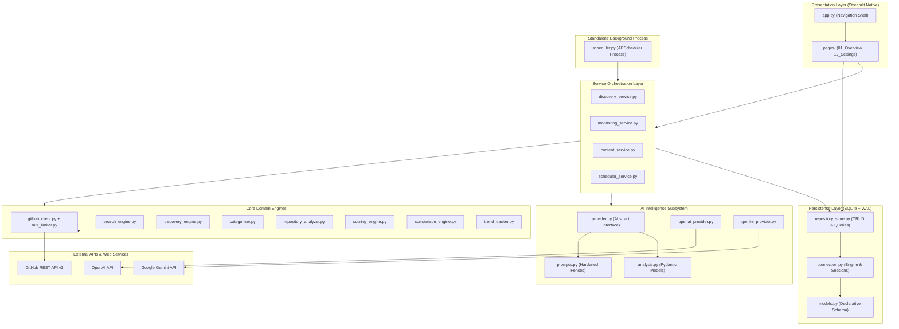
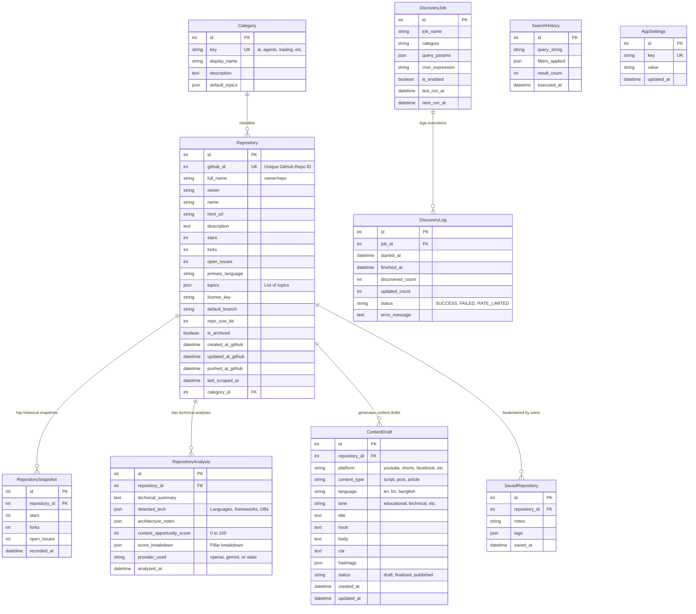

# OpenSource Radar — System Architecture & Component Specifications

## 1. System Overview

**OpenSource Radar** is organized into a modular layered architecture running purely on Python 3.11+. The presentation layer is driven by Streamlit, the storage layer is managed by SQLite via SQLAlchemy 2.0+ ORM with Write-Ahead Logging (WAL), background tasks are driven by APScheduler in a detached process, and external integrations communicate via resilient HTTP clients.



---

## 2. Layer Responsibilities & Subsystems

### 2.1 Presentation Layer (`app.py`, `pages/`)
- Multi-page Streamlit application using native Streamlit widgets.
- Responsive dark-themed interface, consistent sidebar status indicators (GitHub PAT, DB status, AI status).
- 12 Dedicated Pages:
  1. `01_Overview.py`: High-level operational metrics, summary cards, recent discoveries.
  2. `02_Discover.py`: Interactive search with multi-filter query builder (language, stars, topics, pushed date).
  3. `03_Trending.py`: Fast-moving repositories filtered by recent pushes and star velocity.
  4. `04_Hidden_Gems.py`: Under-the-radar repositories with high stars-to-forks ratios and low visibility.
  5. `05_AI_Agents.py`: Curated agentic frameworks, multi-agent tools, and MCP servers.
  6. `06_Trading_FinTech.py`: Curated algorithmic trading, bots, backtesting, and quantitative frameworks.
  7. `07_Repository_Analyzer.py`: Deep technical dossier: README, architecture, file tree, dependencies, AI insights.
  8. `08_Compare.py`: Side-by-side comparative matrix of 2 to 5 repositories.
  9. `09_Content_Studio.py`: Educational content generator for YouTube, Shorts, Socials, and Blogs in EN/BN/Banglish.
  10. `10_Saved_Projects.py`: Personal library of bookmarked repositories and tags.
  11. `11_Analytics.py`: Visual historical trend analytics powered by Plotly and stored snapshots.
  12. `12_Settings.py`: Diagnostic panel: rate-limit gauges, API credentials tester, database vacuum/health.

### 2.2 Core Engines Layer (`core/`)
- `github_client.py`: Resilient HTTP client wrapping GitHub REST API v3. Handles authentication tokens, pagination, rate-limit header tracking, exponential backoff with jitter, and transient error recovery.
- `rate_limiter.py`: Tracks remaining API calls (`X-RateLimit-Remaining`) and reset timestamps (`X-RateLimit-Reset`) to prevent 403 Forbidden throttling.
- `cache.py`: In-memory and disk TTL cache for expensive or static queries (e.g., repository READMEs and file trees).
- `search_engine.py`: Translates UI filter configurations into valid GitHub search query strings (e.g., `topic:agent stars:>50 pushed:>2026-01-01`).
- `discovery_engine.py`: Implements 9 specialized discovery recipes combining targeted query sets and sorting heuristics.
- `categorizer.py`: Rule-based and topic-based classifier mapping repositories to predefined technology domains.
- `repository_analyzer.py`: Inspects repository file trees, README content, licenses, and dependencies purely via static metadata (zero dynamic code execution).
- `scoring_engine.py`: Computes an explainable 0–100 Content Opportunity Score across five distinct pillars.
- `comparison_engine.py`: Aggregates and normalizes multi-repository metrics for side-by-side evaluation.
- `trend_tracker.py`: Computes delta metrics between timestamped historical snapshots.

### 2.3 AI Intelligence Subsystem (`ai/`)
- `provider.py`: Abstract base class `AIProvider` enforcing consistent asynchronous/synchronous analysis and content methods.
- `openai_provider.py`: Implementation for OpenAI models (e.g., `gpt-4o`, `gpt-4o-mini`).
- `gemini_provider.py`: Implementation for Google Gemini models (e.g., `gemini-1.5-flash`, `gemini-1.5-pro`).
- `prompts.py`: Security-hardened prompt templates isolating untrusted repository text inside unambiguous XML-style tags (`<untrusted_content>...</untrusted_content>`).
- `analysis.py`: Pydantic schemas validating model outputs into typed data structures (`StructuredAnalysis`, `ContentDraftSchema`).

### 2.4 Persistence Layer (`database/`)
- `connection.py`: Thread-safe SQLAlchemy engine and session factory (`sessionmaker`). Automatically enforces SQLite `PRAGMA journal_mode=WAL;` and `PRAGMA foreign_keys=ON;` on every connection.
- `models.py`: Declarative SQLAlchemy models.
- `repository_store.py`: High-level data access object (DAO) handling repository upserts, snapshot appends, bookmark toggles, and query pagination.
- `migrations.py`: Schema validation, index enforcement, and safe column additions.

### 2.5 Background Automation (`scheduler.py`, `services/scheduler_service.py`)
- Independent Python process executing outside Streamlit lifecycle to prevent thread contention and session hijacking.
- Backed by `APScheduler` (BackgroundScheduler) reading active jobs from `DiscoveryJob` database records.
- Logs all execution cycles, duration, and discovery yields to `DiscoveryLog`.

---

## 3. Database Schema & Data Models

All models inherit from `declarative_base()` and include audit timestamps.



---

## 4. Key Component Interfaces & Contracts

### 4.1 GitHubClient Contract (`core/github_client.py`)
```python
class GitHubClientProtocol:
    def test_connection(self) -> dict[str, Any]: ...
    def get_rate_limit(self) -> dict[str, int]: ...
    def search_repositories(
        self,
        query: str,
        sort: str = "stars",
        order: str = "desc",
        page: int = 1,
        per_page: int = 30
    ) -> dict[str, Any]: ...
    def get_repository_details(self, owner: str, repo: str) -> dict[str, Any]: ...
    def get_readme(self, owner: str, repo: str) -> str | None: ...
    def get_file_tree(self, owner: str, repo: str, branch: str = "main") -> list[dict[str, Any]]: ...
    def get_file_content(self, owner: str, repo: str, path: str) -> str | None: ...
```

### 4.2 Scoring Model Contract (`core/scoring_engine.py`)
Explainable 0–100 scale:
- **Pillar 1: Trend Momentum (25 pts)**: Observed star growth rate over 24h/7d, commit recency, and issue activity.
- **Pillar 2: Uniqueness (20 pts)**: Rare topic combinations, distinct niche focus, innovation signals in README.
- **Pillar 3: Practical Usefulness (20 pts)**: Presence of runnable examples, clear installation instructions, docker/CLI availability.
- **Pillar 4: Content Appeal (20 pts)**: Visual media in docs, clear problem statement, relevance to trending industry topics.
- **Pillar 5: Project Health Signals (15 pts)**: Verified OSI license, active maintenance, non-archived status, low open bug ratios.

Output schema:
```python
class ScoreBreakdown(BaseModel):
    total_score: int
    trend_momentum: int
    uniqueness: int
    practical_usefulness: int
    content_appeal: int
    quality_signals: int
    reasons: list[str]
    missing_signals: list[str]
```

### 4.3 AI Provider Contract (`ai/provider.py`)
```python
class AIProvider(ABC):
    @abstractmethod
    def analyze_repository(
        self,
        repo_data: dict[str, Any],
        readme_content: str | None,
        tree_summary: list[str]
    ) -> StructuredAnalysis: ...

    @abstractmethod
    def generate_content(
        self,
        repo_data: dict[str, Any],
        analysis: StructuredAnalysis,
        platform: str,
        content_type: str,
        language: str,
        tone: str
    ) -> ContentDraftSchema: ...
```

---

## 5. Security & Threat Modeling

1. **Zero Execution of Repository Payloads**: All analysis operates strictly on JSON metadata, text files (README, requirements, pyproject.toml, package.json), and file path names. No arbitrary scripts, subprocess commands, or package installations are triggered.
2. **Untrusted Input Sanitization**: Repository descriptions, author usernames, README markdown, and commit messages are untrusted. AI prompts wrap these in protective XML boundaries with explicit system instructions to ignore prompt injection directives embedded inside target codebases.
3. **API Key Isolation**: Secrets (`GITHUB_TOKEN`, `OPENAI_API_KEY`, `GEMINI_API_KEY`) are read strictly into private memory via Pydantic settings. UI views display only credential presence/health checks and masked indicators (e.g., `ghp_****1234`).
4. **SQLite Concurrency & WAL Mode**: SQLite runs in WAL mode (`PRAGMA journal_mode=WAL`) to allow the background scheduler process to write snapshots concurrently without locking the Streamlit UI dashboard read transactions.
