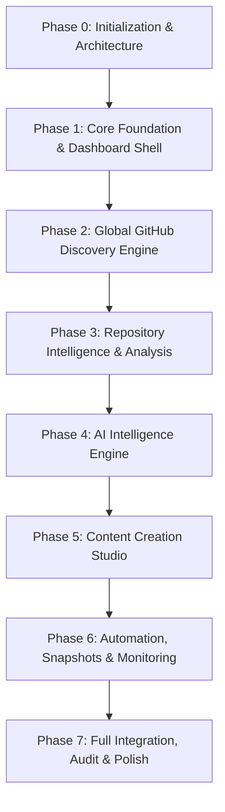

# OpenSource Radar — Phased Implementation Plan

This document defines the roadmap, dependencies, architectural prerequisites, and milestone completion criteria for all development phases of **OpenSource Radar**.

---

## Roadmap Overview

---

## Phase Details & Specifications

### Phase 0: Project Initialization & Architecture
- **Objective**: Establish development foundation, directory hierarchy, core memory files, dependency pinning, and system architecture specifications.
- **Key Tasks**:
  - [x] Inspect workspace and Python runtime environment.
  - [x] Create core directory structure (`core/`, `ai/`, `database/`, `services/`, `utils/`, `pages/`, `data/`, `logs/`, `tests/`).
  - [x] Pin dependencies in `requirements.txt`.
  - [x] Define environment variables template in `.env.example`.
  - [x] Configure `.gitignore` for secrets, SQLite databases, and cache.
  - [x] Formulate project documentation in `README.md`.
  - [x] Author the 7 mandatory memory files.
  - [x] Document database schemas, engine interfaces, and component boundaries.
- **Dependencies**: None.
- **Status**: IN PROGRESS (Completing Phase 0 tasks).

---

### Phase 1: Core Foundation & Python Dashboard Shell
- **Objective**: Implement configuration validation, reusable GitHub REST client, database connection with SQLite WAL mode, declarative models, and full multipage Streamlit navigation.
- **Key Tasks**:
  - [x] Implement `config.py` using Pydantic Settings with secret masking.
  - [x] Implement `core/github_client.py` with retry logic, rate limiting, and token handling.
  - [x] Implement `database/connection.py` with thread-safe session management & SQLite WAL mode.
  - [x] Implement initial SQLAlchemy models in `database/models.py` (all 10 models).
  - [x] Implement `database/migrations.py` to seed 8 technology domain categories.
  - [x] Implement `database/repository_store.py` DAO for deduplication, upserts, and bookmarks.
  - [x] Implement `app.py` and all 12 page shells in `pages/` with consistent dark-themed UI.
  - [x] Implement `pages/12_Settings.py` for live connection testing (GitHub, DB, AI, Cache).
  - [x] Implement automated test suite covering config, database, GitHub client, and dashboard imports (22/22 passed).
- **Dependencies**: Phase 0.
- **Status**: COMPLETED.

---

### Phase 2: Global GitHub Discovery Engine
- **Objective**: Implement multi-category technology radar and search engine backed by real GitHub public repository data.
- **Key Tasks**:
  - [x] Implement technology domain taxonomy in `core/categorizer.py` across 6 core domains and 60+ subcategories.
  - [x] Implement `core/search_engine.py` with GitHub query generation syntax and filter combinations.
  - [x] Implement `core/discovery_engine.py` supporting 9 discovery modes (Trending, Hidden Gems, New Repositories, AI & Agents, Trading & FinTech, Cybersecurity, etc.).
  - [x] Implement 16-field normalization and deduplicating persistence in `database/repository_store.py`.
  - [x] Connect live discovery results to Streamlit discovery and category pages (`02_Discover.py`, `03_Trending.py`, `04_Hidden_Gems.py`, `05_AI_Agents.py`, `06_Trading_FinTech.py`).
  - [x] Implement reusable `render_repository_card` with bookmark and analyze actions.
  - [x] Implement comprehensive automated test suites for search query generation, categorization, and discovery.
- **Dependencies**: Phase 1 (GitHub Client, Database Models, Dashboard Shell).
- **Status**: COMPLETED.

---

### Phase 3: Repository Intelligence & Analysis
- **Objective**: In-depth static inspection of discovered repositories, 2-5 repository comparison, and an explainable 0–100 content opportunity scoring model.
- **Key Tasks**:
  - [x] Implement `core/repository_analyzer.py` for static README parsing, dependency detection, and file tree inspection (strictly zero dynamic code execution).
  - [x] Implement safe source inspection limits with binary file rejection and 100KB guard.
  - [x] Implement `core/comparison_engine.py` for side-by-side technical evaluation across 2 to 5 repositories.
  - [x] Implement `core/scoring_engine.py` with 5 explainable scoring pillars (Trend Momentum, Uniqueness, Practical Usefulness, Content Appeal, Quality Signals).
  - [x] Connect `pages/07_Repository_Analyzer.py` with multi-tab research view and DB persistence into `RepositoryAnalysis`.
  - [x] Connect `pages/08_Compare.py` with comparative matrix and dependency overlap detection.
  - [x] Implement automated test suite covering README parsing, binary rejection, scoring, and comparison matrix (42/42 passed).
- **Dependencies**: Phase 2 (Repository data in DB).
- **Status**: COMPLETED.

---

### Phase 4: AI Intelligence Engine
- **Objective**: Introduce structured AI analysis capabilities with OpenAI and Gemini integrations, hardened against prompt-injection.
- **Key Tasks**:
  - [x] Implement abstract AI provider interface in `ai/provider.py` with custom exception hierarchy.
  - [x] Implement `ai/openai_provider.py` utilizing JSON response mode and Pydantic validation.
  - [x] Implement `ai/gemini_provider.py` utilizing Google Generative AI JSON output.
  - [x] Author hardened prompts with strict security delimiters (`<untrusted_repository_content>`) in `ai/prompts.py`.
  - [x] Implement Pydantic output validation in `ai/analysis.py` (`StructuredAnalysis`, `ImportantFileInsight`).
  - [x] Integrate "Analyze with AI" action in `pages/07_Repository_Analyzer.py` with DB caching to eliminate duplicate API costs.
  - [x] Ensure 100% functional fallback when AI credentials are absent (deterministic static analysis).
  - [x] Implement automated test suite covering schemas, injection fences, provider factory, and fallbacks (47/47 passed).
- **Dependencies**: Phase 3 (Repository analysis data & static metrics).
- **Status**: COMPLETED.

---

### Phase 5: Content Creation Studio
- **Objective**: Multi-platform, multi-format, multi-language educational content synthesis with draft persistence and editing.
- **Key Tasks**:
  - [x] Implement platform templates (YouTube Long/Shorts, Facebook, Instagram, Telegram, Blogs, Tutorials) in `core/content_generator.py` and `services/content_service.py`.
  - [x] Support English, Bengali, and Banglish language generations.
  - [x] Implement Content Studio UI in `pages/09_Content_Studio.py` with editing, regenerating, downloading, and copying.
  - [x] Connect database persistence for drafts in `ContentDraft` model.
  - [x] Implement comprehensive unit tests in `tests/test_content_studio.py` (52/52 tests passing).
- **Dependencies**: Phase 4 (AI Engine) and Phase 3 (Scored Repositories).
- **Status**: COMPLETED.

---

### Phase 6: Automation, Historical Analytics & Monitoring
- **Objective**: Independent background scheduler for recurring discovery and historical snapshot time-series tracking.
- **Key Tasks**:
  - [x] Implement `scheduler.py` powered by APScheduler as a distinct Python process with PID lockfile.
  - [x] Implement time-series tracking in `RepositorySnapshot` (calculate 24h, 7d, 30d star growth percentages without fabrication).
  - [x] Implement discovery jobs configuration and execution logging in `DiscoveryJob` and `DiscoveryLog`.
  - [x] Extend `pages/11_Analytics.py` with Plotly charts visualizing actual recorded growth and distributions.
  - [x] Implement notification hooks in `services/monitoring_service.py` (Log and optional Telegram alerts).
  - [x] Implement automated test suites in `tests/test_trend_tracker.py` and `tests/test_scheduler.py` (63/63 passing).
- **Dependencies**: Phase 2, Phase 3, Phase 5.
- **Status**: COMPLETED.

---

### Phase 7: Full Integration, Testing & Production Polish
- **Objective**: Comprehensive end-to-end integration audit, full test suite execution, security verification, and documentation wrap-up.
- **Key Tasks**:
  - [x] End-to-end user workflow verification across all 12 dashboard pages and 20 critical workflows.
  - [x] Run full Pytest test suite covering unit, integration, and UI import tests (70/70 passing).
  - [x] Perform security audit (secret leak checks, prompt injection isolation, zero-execution verification).
  - [x] Complete comprehensive operational guide and troubleshooting documentation in `README.md`.
  - [x] Finalize `requirements.txt`, `.env.example`, and `.gitignore`.
- **Dependencies**: Phases 0–6.
- **Status**: COMPLETED.

---

### Phase 8: Telegram Auto-Alerts & Interactive Repository AI Chat
- **Objective**: Real-time push notifications to Telegram channels/users on high-potential projects, and conversational AI Q&A grounded strictly in repository dossiers.
- **Key Tasks**:
  - [x] Implement `TelegramService` in `services/telegram_service.py` with HTML repository card formatting and test ping execution.
  - [x] Integrate Telegram dispatch in `services/scheduler_service.py` and `services/monitoring_service.py` for high-scoring repositories.
  - [x] Add interactive Telegram connection testing and sample dispatch in `pages/12_Settings.py`.
  - [x] Extend AI prompt engineering in `ai/prompts.py` with `SYSTEM_CHAT_PROMPT` and `build_chat_prompt` featuring untrusted input XML fences.
  - [x] Implement `chat_with_repository` across `AIProvider`, `OpenAIProvider`, and `GeminiProvider` with deterministic offline fallback.
  - [x] Embed interactive Streamlit Chat Assistant in `pages/07_Repository_Analyzer.py` with 1-click quick questions (Docker, Architecture, Use Cases, Dependencies).
  - [x] Implement unit tests in `tests/test_telegram_service.py` and `tests/test_chat_with_repository.py` (81/81 full suite passing).
- **Dependencies**: Phases 1–7.
- **Status**: COMPLETED.
